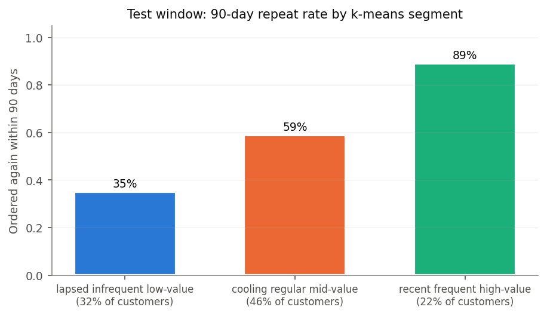
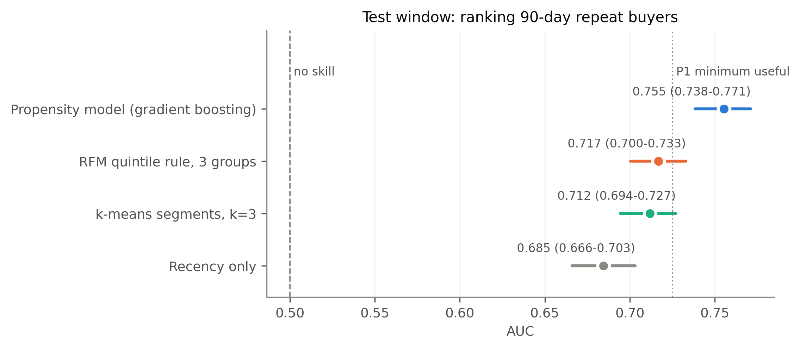
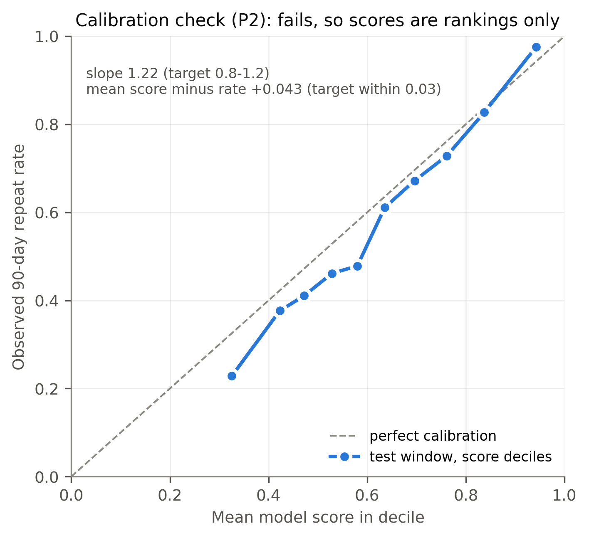

# Which customers will order again?


**This project sorts a UK online gift retailer's customers into three groups that show who is likely to order again within 90 days, and finds that a simple scoring rule separates them about as well as a machine-learning method.**

> **Illustrative scenario.** The retailer data is real (2009-2011), but the business setting, a CRM team planning its quarter, is invented. The data has **no marketing contact records**, so nothing here shows what happens when you contact a customer.
>
> **Registered customers only.** 243,007 of 1,067,371 invoice lines (22.8%) have no customer ID and are excluded. The results say nothing about guest buyers.

## The question
A sales team can only talk to so many customers each quarter. Which customers are likely to order again on their own, and which are drifting away?

We grouped customers by how recently, how often and how much they buy. We then checked what each group did over the next 90 days. The check used a later period (September to December 2011) than the one used to build the groups, so the groups were tested on behaviour they had not seen.

## What we found

*Share of customers in each group who ordered again within 90 days of the test date. These are observed rates for 3,238 customers, not model output.*

| Group | Share of customers | Ordered again within 90 days |
|---|---|---|
| Lapsed, infrequent, low spend | 32% | 35% |
| Cooling, regular, mid spend | 46% | 59% |
| Recent, frequent, high spend | 22% | 89% |

- **The groups separate repeat buyers from lapsing ones.** Customers in the top group were about two and a half times as likely to order again as customers in the bottom group.
- **A simple rule does the job.** A rule that scores each customer from 1 to 5 on recency, frequency and spend, adds the scores up and splits customers into three groups (a few lines of SQL) performed about as well as k-means clustering. The data cannot tell the two apart, so we recommend the rule because anyone on the team can read and audit it.
- **A model can put customers in order, a little.** A gradient-boosted model ranked likely repeat buyers above chance, including inside each group. It ranked less well inside the low and middle groups. Its scores are not probabilities (it over-predicted overall), so use its order and ignore its values.
- **What the data cannot say.** Whether contacting a customer makes them order more. There are no contact records to learn that from.

## What we recommend
1. **Group customers each quarter with the simple scoring rule.** Keep the cut points fixed from an earlier period.
2. **Use the three plain-language group names** to describe the customer base. They describe who ordered again, not why.
3. **Within a group, use the model's ranking to decide who to look at first.** This is the least certain recommendation. We loosened the rule for when the model may be used this way after seeing the test results, and we did not test whether the model beats the groups alone. Treat it as a hypothesis.
4. **Run a randomised holdout before spending on contact.** Contact a random half of a customer list, leave the other half alone, and compare how many in each half order within 90 days. That is the direct way to measure the effect of contact, which this data cannot show.

A worked example with invented costs sits in [docs/BUSINESS_IMPACT.md](docs/BUSINESS_IMPACT.md). It shows why picking the customers most likely to order is not the same as picking the customers worth contacting.

## How far to trust this
- **Later period, same customers.** The groups were built on an earlier period and tested on a later one. Most test customers (2,443 of 3,238, or 75.4%) were also in the earlier period, so this checks later behaviour, not brand-new customers.
- **The test period was not untouched.** A prototype ran on it before the plan was fixed, and the final pipeline scored it six times. No choice changed after the first score. See [METHODOLOGY.md, section 6](docs/METHODOLOGY.md#6-disclosure-use-of-the-test-window).
- **One plan rule changed after the results.** The rule for using the model inside groups was loosened after the test scores were seen ([METHODOLOGY.md, section 7](docs/METHODOLOGY.md#7-changes-to-the-plan), item 6).
- **One retailer, 2009-2011, with many wholesale buyers.** Group definitions and rates may not carry over to other businesses.

## Results for analysts
All results come from the test period (cutoff 2011-09-11; 3,238 customers, 1,868 of whom ordered again). Segments were fitted on an earlier period (cutoff 2011-03-15) and the feature set was chosen on another (cutoff 2011-06-13). Intervals are 95% bootstrap CIs over 1,000 customer resamples, and verdicts are computed in code.

| Finding | Evidence (test period) | Strength |
|---|---|---|
| Three k-means segments rank future repeat buyers above chance | Segment-score AUC 0.712 (0.694-0.727) vs 0.5 for random segments | **STRONG** (computed verdict) |
| The segments are stable under resampling | Bootstrap ARI 5th percentile 0.882 on the fitting period (minimum useful 0.70) | Target met |
| A 3-group RFM quintile rule is not distinguishable from k-means | Rule AUC 0.717 (0.700-0.733); k-means minus rule -0.005 (-0.014 to +0.004) | Interval spans 0; no verdict computed for the rule |
| Segments add a small amount beyond recency alone | Recency + segments minus recency: +0.033 (+0.027 to +0.040) | CI excludes 0 |
| A customer-level model ranks repeat buyers above chance | AUC 0.755 (0.738-0.771); train 0.804, gap 0.049, below the 0.15 overfit flag | **STRONG** (computed verdict) |
| The model still ranks above chance inside each k-means segment | Within-segment AUC 0.625 (0.589-0.660), 0.624 (0.596-0.654) and 0.750 (0.699-0.798) | Descriptive; no verdict computed |
| Model scores are not reliable probabilities | Calibration slope 1.220 (target 0.8-1.2), mean score 0.043 above the observed rate (limit 0.03) | **Check failed** |

Both STRONG verdicts compare against chance (0.5). No paired test compares the customer-level model with the segments or the rule, so no claim is made that it ranks better than either.


*Test-period AUC with 95% CIs. Propensity model and k-means segments: computed verdict STRONG. The RFM rule and recency-only rows are comparators with no verdict. The dotted line is P1's minimum-useful target, set using the same period in the initial feasibility check.*


*Calibration check (P2) on the test period: it **fails** (slope 1.22, mean score 0.043 above the observed rate). The scores are used for ranking only and are never read as probabilities.*

## Approach
1. **Clean** 1,067,371 invoice lines in DuckDB SQL: drop lines with no customer ID, non-product codes, zero prices and exact duplicates; net off cancellations; remove giant mistaken orders together with the cancellation that reverses them.
2. **Build customer snapshots** at four cutoffs. Features use the 273 days before each cutoff; the label is any purchase in the 90 days after it.
3. **Segment** with k-means on recency, frequency and net spend, fitted on the dev window (cutoff 2011-03-15) and frozen. k=3 is chosen by bootstrap stability.
4. **Compare** with random segments, recency alone and an RFM quintile rule written in SQL.
5. **Model** 90-day repeat purchase: L2 logistic regression against gradient boosting, chosen on the val window (cutoff 2011-06-13), then retrained on all earlier windows.
6. **Evaluate on the test window** (cutoff 2011-09-11) with every choice frozen.

Details: [docs/METHODOLOGY.md](docs/METHODOLOGY.md). Columns and outputs: [docs/DATA_DICTIONARY.md](docs/DATA_DICTIONARY.md).

## Limitations
- No contact or campaign data: nothing here is a response rate or a causal effect.
- Calibration fails on the test window, whose label period is the September-December peak, so scores are rankings only.
- Registered customers only: 22.8% of raw lines have no customer ID.
- Out-of-time, not out-of-customer: most test customers were also in the window the segments were fitted on.
- The test window informed the plan's targets and training design through the initial feasibility check.
- One retailer, 2009-2011, with many wholesale buyers. Segment definitions and rates may not transfer.

## Repository
```
sql/            DuckDB SQL: cleaning, snapshot features, labels, RFM rule
src/segmentation_propensity/   pipeline modules (data, features, segmentation, propensity, gate, insights, visualization)
scripts/        download_data.py, run_pipeline.py, check_consistency.py
notebooks/      01 EDA, 02 segmentation, 03 propensity, 04 business insights
outputs/        figures/ and metrics/ (results.json, evidence_gate.md, supporting tables)
tests/          fixture-based tests; no data download needed
```

## Reproduce
Python 3.11-3.13. Commands below are for Windows; use `.venv/bin/python` on macOS or Linux.

**1. Install and test (no data needed).** The tests use small synthetic fixtures and run segment selection, propensity selection and the evidence gate end to end.
```
python -m venv .venv
.venv/Scripts/python -m pip install -r requirements-dev.txt
.venv/Scripts/python -m pip install -e . --no-deps
.venv/Scripts/python -m pytest
.venv/Scripts/python scripts/check_consistency.py    # numbers in the README and docs trace to outputs/metrics
```

**2. Download the raw data from the official source.** No data is committed.
```
.venv/Scripts/python scripts/download_data.py
```
| Item | Value |
|---|---|
| Source | UCI Machine Learning Repository, `https://archive.ics.uci.edu/static/public/502/online+retail+ii.zip` |
| Downloaded file | `data/raw/online_retail_ii.zip` |
| Expected SHA-256 of the zip | `572e36277c2390fbfde10664750731e0a86f55e33470d91919085f0408e67bfb` |
| Archive member | `online_retail_II.xlsx`, extracted to `data/raw/extracted/` |
| Output | `data/raw/online_retail_II.csv` with `1,067,371` rows and `8` columns |

The script stops with an error if the checksum, archive contents, columns or row count differ. An existing zip is reused and its checksum checked again. To re-run the extraction, delete `data/raw/extracted/` first.

**3. Rebuild the results.**
```
.venv/Scripts/python scripts/run_pipeline.py         # about two minutes; writes outputs/metrics/results.json and evidence_gate.md
```
The pipeline is deterministic: two runs give byte-identical `results.json`. To execute the notebooks, also install `requirements-notebooks.txt`, then run them in order from the `notebooks/` folder.

## Data and licence
Online Retail II by Daqing Chen, UCI Machine Learning Repository, [doi:10.24432/C5CG6D](https://doi.org/10.24432/C5CG6D), licensed under [CC BY 4.0](https://creativecommons.org/licenses/by/4.0/). No data is committed; see [data/README.md](data/README.md). Code is MIT licensed (see `LICENSE`).
