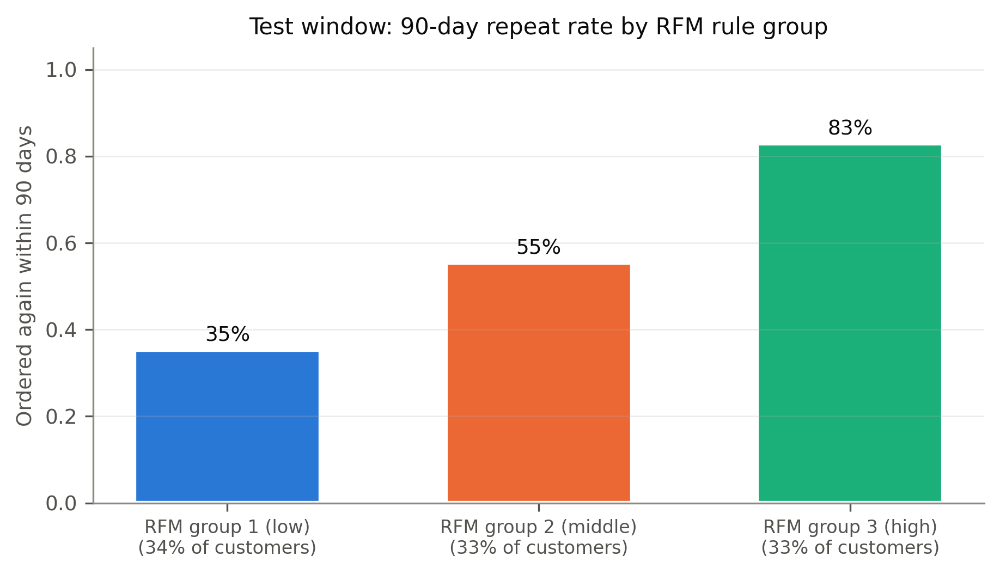

# Customer segmentation with an out-of-time repeat-purchase check

> **Illustrative scenario.** The business framing (a CRM team planning quarterly account management) is invented. The data is real: a UK online gift retailer, 2009-2011, with many wholesale buyers. It contains **no marketing contact data**, so every result describes the likelihood of ordering again within 90 days, not response to marketing.
>
> **Registered customers only.** 243,007 of 1,067,371 raw invoice lines (22.8%) have no customer ID and are excluded, so the segments describe registered customers and say nothing about guest buyers.

## Summary
Customers fall into three groups whose 90-day repeat rates differ sharply on a later, held-out quarter: from 35% to 89% for the k-means segments, and from 35% to 83% for a simple RFM rule. Ranking customers by their segment places repeat buyers above chance (AUC 0.712, 95% CI 0.694-0.727; computed verdict STRONG). The RFM quintile rule, written in SQL, is **not distinguishable from k-means** (paired difference spans 0) and is simpler to run, so it is the recommended operational segmentation, with the k-means segments kept as plain-language profiles. A customer-level model ranks repeat buyers above chance (AUC 0.755, 95% CI 0.738-0.771; verdict STRONG), and it still ranks above chance inside every segment. Its scores failed a calibration check, so they are used as a ranking only. The data cannot show whether contacting customers changes what they do; a randomised holdout test is the next step before any spend.

## Key findings
Every segment and model result below comes from the test window (cutoff 2011-09-11; 3,238 customers, 1,868 of whom ordered again). The segments were fitted on an earlier window (cutoff 2011-03-15) and the feature set was chosen on another (cutoff 2011-06-13), so no segment claim is judged on the window it was built on. This is an out-of-time check, not a check on new customers: 2,443 of the 3,238 test customers (75.4%) were also in the window the segments were fitted on. Intervals are 95% bootstrap CIs over 1,000 customer resamples; verdicts are computed in code.

| Finding | Evidence (test window) | Strength |
|---|---|---|
| Three k-means segments rank future repeat buyers above chance | Segment-score AUC 0.712 (0.694-0.727) vs 0.5 for random segments | **STRONG** (computed verdict) |
| The segments are stable under resampling | Bootstrap ARI 5th percentile 0.882 on the fitting window (minimum useful 0.70) | Target met |
| A 3-group RFM quintile rule is not distinguishable from k-means | Rule AUC 0.717 (0.700-0.733); k-means minus rule -0.005 (-0.014 to +0.004) | Interval spans 0; no verdict computed for the rule |
| Segments add a small amount beyond recency alone | Recency + segments minus recency: +0.033 (+0.027 to +0.040) | CI excludes 0 |
| A customer-level model ranks repeat buyers above chance | AUC 0.755 (0.738-0.771); train 0.804, gap 0.049, below the 0.15 overfit flag | **STRONG** (computed verdict) |
| The model still ranks above chance inside each k-means segment | Within-segment AUC 0.625 (0.589-0.660), 0.624 (0.596-0.654) and 0.750 (0.699-0.798) | Descriptive; no verdict computed |
| Model scores are not reliable probabilities | Calibration slope 1.220 (target 0.8-1.2), mean score 0.043 above the observed rate (limit 0.03) | **Check failed** |

No paired test compares the customer-level model with the segments or the rule, so no claim is made that it ranks better than either.

**How the test window was used.** The test window was scored six times in total: the first run, then five re-runs to check a record-merging fix and to remove run-to-run non-determinism. No choice changed after the first score, and the final numbers equal it. Release checks also re-run the full pipeline from a fresh clone as a reproducibility test; such runs inform no choice, and they reproduce `results.json` byte-for-byte. Before the analysis plan was fixed, an initial feasibility check also ran a prototype of this approach on the same window, and its results informed the minimum-useful targets and the training-window design. The S1 and P1 intervals clear chance by more than 0.10 on their own (lower bounds 0.694 and 0.738 against 0.5); only the "minimum useful met" part of each verdict relied on targets set using this window. Details: [METHODOLOGY.md, sections 6-7](docs/METHODOLOGY.md#6-disclosure-use-of-the-test-window).


*Test-window AUC with 95% CIs. Propensity model and k-means segments: computed verdict STRONG. The RFM rule and recency-only rows are comparators with no verdict. The dotted line is P1's minimum-useful target, set using the same window in the initial feasibility check.*


*Share of customers in each RFM rule group who ordered again within 90 days of the test cutoff. Observed rates, not model output. Cut points were fixed on the earlier fitting window.*


*Calibration check (P2) on the test window: it **fails** (slope 1.22, mean score 0.043 above the observed rate). The scores are used for ranking only and are never read as probabilities.*

## Recommendations
1. Use the **RFM quintile rule** (3 groups, cut points fixed on an earlier window) as the operational segmentation. It is not distinguishable from k-means (the S2 interval spans 0) and is simpler to run and audit.
2. Keep the **k-means segments** as descriptive profiles: *lapsed infrequent low-value*, *cooling regular mid-value* and *recent frequent high-value*. Re-check them each quarter: the fitted model and a refit on a later window agree at ARI 0.788.
3. **Order customers within each group by the model's rank**, never by its score value.
4. **Run a randomised holdout** before scaling any contact programme. The data has no contact records, so the effect of contact is unknown.

The contact-list arithmetic is kept separate from these findings, in the illustrative scenario section of [docs/BUSINESS_IMPACT.md](docs/BUSINESS_IMPACT.md). It uses unsourced assumptions, and the effect of contact is recorded there as not estimable.

## Approach
1. **Clean** 1,067,371 invoice lines in DuckDB SQL: drop lines with no customer ID, non-product codes, zero prices and exact duplicates; net off cancellations; remove giant mistaken orders together with the cancellation that reverses them.
2. **Build customer snapshots** at four cutoffs. Features use the 273 days before each cutoff; the label is any purchase in the 90 days after it.
3. **Segment** with k-means on recency, frequency and net spend, fitted on the dev window (cutoff 2011-03-15) and frozen. k=3 is chosen by bootstrap stability.
4. **Compare** with random segments, recency alone and an RFM quintile rule written in SQL.
5. **Model** 90-day repeat purchase: L2 logistic regression against gradient boosting, chosen on the val window (cutoff 2011-06-13), then retrained on all earlier windows.
6. **Evaluate on the test window** (cutoff 2011-09-11) with every choice frozen. Verdicts are computed in code from the confidence intervals; see "How the test window was used" above.

Details: [docs/METHODOLOGY.md](docs/METHODOLOGY.md). Columns and outputs: [docs/DATA_DICTIONARY.md](docs/DATA_DICTIONARY.md).

## Limitations
- No contact or campaign data: nothing here is a response rate or a causal effect.
- Calibration fails on the test window, whose label period is the September-December peak, so scores are rankings only.
- Registered customers only: 22.8% of raw lines have no customer ID.
- Out-of-time, not out-of-customer: most test customers were also in the window the segments were fitted on.
- The test window informed the plan's targets and training design through the initial feasibility check (see above).
- One retailer, 2009-2011, with many wholesale buyers. Segment definitions and rates may not transfer.

## Repository
```
sql/            DuckDB SQL: cleaning, snapshot features, labels, RFM rule
src/segmentation_propensity/   pipeline modules (data, features, segmentation, propensity, gate, insights, visualization)
scripts/        download_data.py, run_pipeline.py, check_consistency.py
notebooks/      01 EDA, 02 segmentation, 03 propensity, 04 business insights
outputs/        figures/ and metrics/ (results.json, evidence_gate.md, supporting tables)
tests/          fixture-based tests; no data download needed
```

## Reproduce
Python 3.11-3.13. Commands below are for Windows; use `.venv/bin/python` on macOS or Linux.

**1. Install and test (no data needed).** The tests use small synthetic fixtures and run segment selection, propensity selection and the evidence gate end to end.
```
python -m venv .venv
.venv/Scripts/python -m pip install -r requirements-dev.txt
.venv/Scripts/python -m pip install -e . --no-deps
.venv/Scripts/python -m pytest
.venv/Scripts/python scripts/check_consistency.py    # numbers in the README and docs trace to outputs/metrics
```

**2. Download the raw data from the official source.** No data is committed.
```
.venv/Scripts/python scripts/download_data.py
```
| Item | Value |
|---|---|
| Source | UCI Machine Learning Repository, `https://archive.ics.uci.edu/static/public/502/online+retail+ii.zip` |
| Downloaded file | `data/raw/online_retail_ii.zip` |
| Expected SHA-256 of the zip | `572e36277c2390fbfde10664750731e0a86f55e33470d91919085f0408e67bfb` |
| Archive member | `online_retail_II.xlsx`, extracted to `data/raw/extracted/` |
| Output | `data/raw/online_retail_II.csv` with `1,067,371` rows and `8` columns |

The script stops with an error if the checksum, archive contents, columns or row count differ. An existing zip is reused and its checksum checked again. To re-run the extraction, delete `data/raw/extracted/` first.

**3. Rebuild the results.**
```
.venv/Scripts/python scripts/run_pipeline.py         # about two minutes; writes outputs/metrics/results.json and evidence_gate.md
```
The pipeline is deterministic: two runs give byte-identical `results.json`. To execute the notebooks, also install `requirements-notebooks.txt`, then run them in order from the `notebooks/` folder.

## Data and licence
Online Retail II by Daqing Chen, UCI Machine Learning Repository, [doi:10.24432/C5CG6D](https://doi.org/10.24432/C5CG6D), licensed under [CC BY 4.0](https://creativecommons.org/licenses/by/4.0/). No data is committed; see [data/README.md](data/README.md). Code is MIT licensed (see `LICENSE`).
